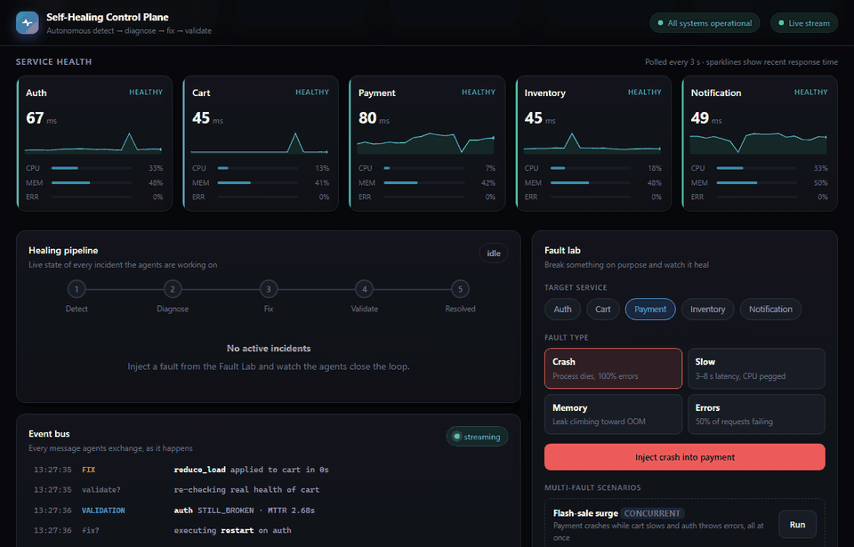
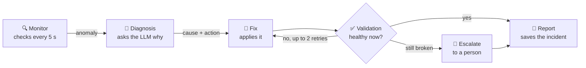
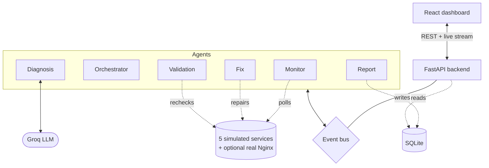
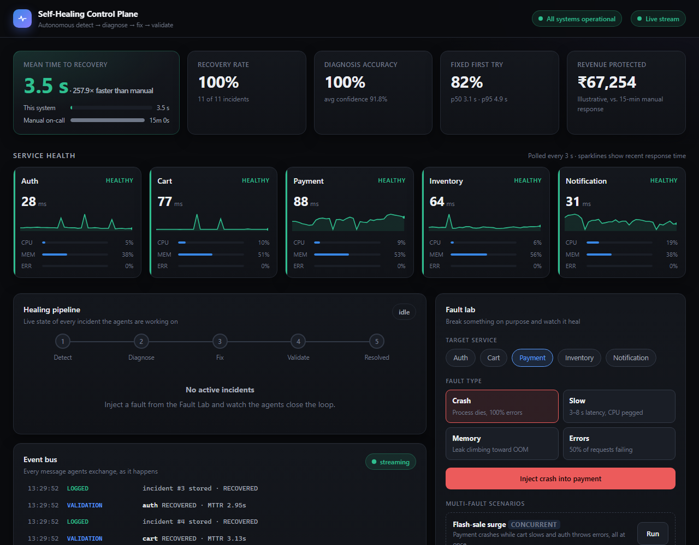
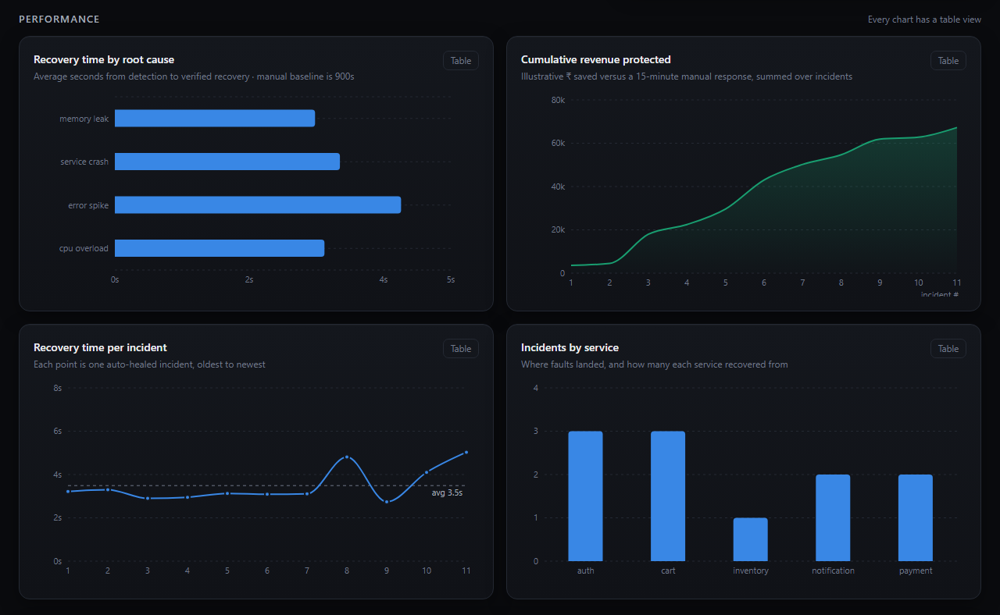
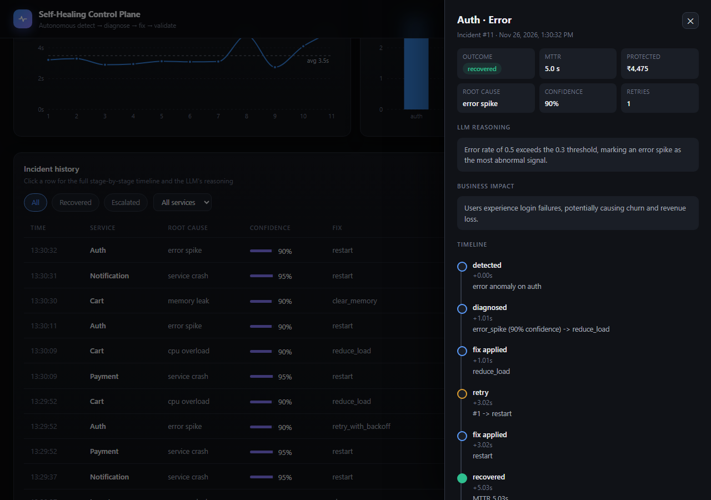
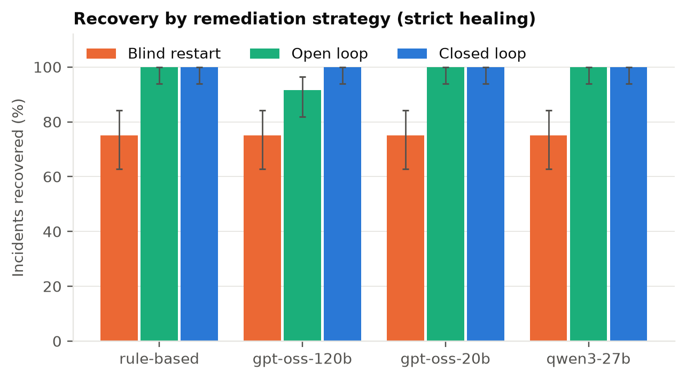
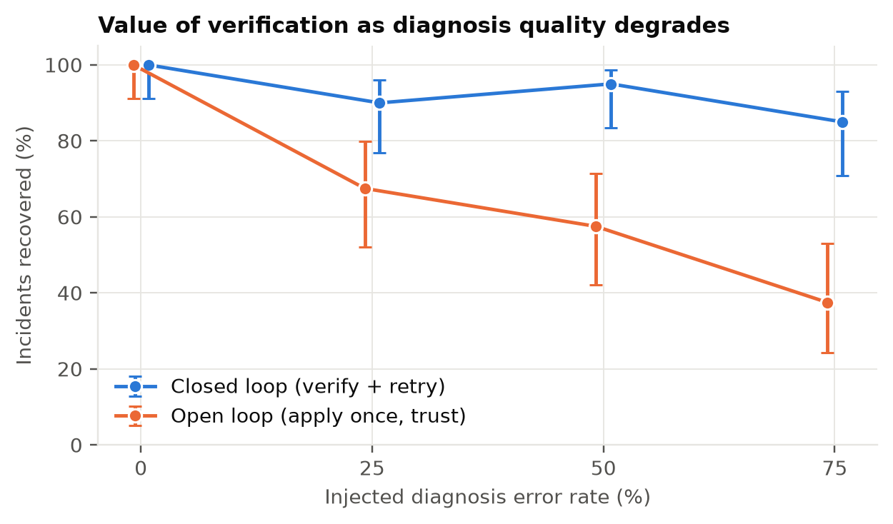

<div align="center">

# Self-Healing E-Commerce Microservices

**AI agents that detect a failing service, work out why, fix it, check that the fix worked, and try again if it didn't.**

[](https://github.com/codeitanshika/Self-Healing-E-commerce-microservices/actions/workflows/ci.yml)


### [Live dashboard](https://self-healing-e-commerce-microservic.vercel.app) · [API docs](https://self-healing-backend-m1e1.onrender.com/docs) · [Quick start](#quick-start) · [Results](#results)



<sub>Three services fail at once and recover with no human action. Recorded from the real app, slowed down for reading.</sub>

</div>

| **3.2 s** | **99.8%** | **179 / 180** | **₹0** |
|:---:|:---:|:---:|:---:|
| mean recovery time in the benchmark | recovery with verify-and-retry (660 simulated incidents) | correct LLM diagnoses | paid services used |

> The first visit to the live demo can take up to a minute while the free backend wakes up. Its incident history resets when the backend restarts.

---

## The problem

When a microservice fails, someone has to notice, find the cause, act and confirm the service is back.

| Approach | What it does | What is left open |
|---|---|---|
| Alerting (Datadog, PagerDuty) | Detects and pages a person | A person diagnoses and fixes |
| Restart probes (Kubernetes) | Restarts quickly | Same action for every fault |
| LLM root-cause tools | Explain the likely cause | Many stop before acting |
| **This project** | Detects → diagnoses → fixes → verifies → retries | A small, free testbed to measure each step |

Research systems that close this loop in real cloud environments also exist. This project focuses on being small enough to run on a laptop and to measure what each stage contributes.

---

## How it works



Agents never call each other. They publish and subscribe to events on a small in-process **event bus**, and an **Orchestrator** decides what happens next.



| Agent | Job | Publishes |
|---|---|---|
| **Monitor** | Polls every service and flags values over a threshold | `ANOMALY_DETECTED` |
| **Diagnosis** | Sends metrics to the LLM: cause, confidence, action, explanation | `DIAGNOSIS_READY` |
| **Fix** | Runs one of five actions | `FIX_APPLIED` |
| **Validation** | Re-reads the real health after the fix | `VALIDATION_RESULT` |
| **Report** | Stores the incident, timeline and recovery time | `INCIDENT_LOGGED` |

### Faults and fixes

| Fault | Detected when | Actions that cure it |
|---|---|---|
| 💥 Crash | service is down | `restart` |
| 🐢 Slow | response over 2000 ms | `reduce_load`, `reroute_traffic` |
| 🧠 Memory leak | memory over 85% | `clear_memory`, `restart` |
| ⚠️ Error spike | error rate over 30% | `retry_with_backoff`, `restart` |

An action that does not suit the fault leaves the service broken, so the retry loop has real work to do. Each retry uses an action not yet tried.

---

## Dashboard



<table>
<tr>
<td width="50%" valign="top"><br><sub><b>Performance charts</b>, each with a table view.</sub></td>
<td width="50%" valign="top"><br><sub><b>Incident detail.</b> The model's first action failed, validation caught it, and the retry recovered the service.</sub></td>
</tr>
</table>

Use the **Fault lab** to break a single service or launch a multi-fault scenario, then watch the pipeline.

---

## Results

### Does closing the loop help?

660 incidents across three LLMs and a rule baseline, where only a suitable fix cures a fault ([full table](docs/results/strategy-comparison.md)).

| Strategy | Recovery rate |
|---|---|
| Blind restart (no diagnosis, no check) | 75.0% |
| Open loop (diagnose, apply once, trust it) | 95.5% |
| **Closed loop (verify, retry, escalate)** | **99.8%** |



Most of the gain over the open loop comes from `gpt-oss-120b` (86% to 100%): it named every cause correctly but often picked a fix that did not work. For the other diagnosers the difference is not statistically significant.

### What if the diagnosis is wrong?



With diagnoses deliberately corrupted, the closed loop recovered 92% against 66% for the open loop ([details](docs/results/verification-under-noise.md)).

> **Read these with care.** The services are simulated and the table of which fix cures which fault is our own assumption. The advantage over blind restart would disappear if a restart cured everything ([sensitivity](docs/results/sensitivity.md)). These runs used `RETRY_POLICY=repeat`; the app now defaults to `distinct`, which the charts do not reflect.

### Diagnosis accuracy and speed

180 trials across 3 free Groq models, run with any-fix-heals (`STRICT_HEALING=0`):

| Metric | Result |
|---|---|
| LLM diagnosis accuracy (pooled) | 99.4% (179/180) |
| Rule-based baseline accuracy | 100% (180/180) |
| Mean MTTR | 3.20s vs. a 900s manual baseline (~99.6% reduction) |

The one LLM miss was a transient API/JSON-parsing failure caught by the system's safe-default fallback, not a reasoning error. Per-model numbers and caveats: [`docs/results/model-comparison.md`](docs/results/model-comparison.md), [`backend/experiments/findings.md`](backend/experiments/findings.md). A real Nginx container recovered 10/10 times with a mean MTTR of 10.0s ([pipeline latency](docs/results/pipeline-latency.md)).

---

## Quick start

### Prerequisites
- Python 3.12+ (the analysis packages in `requirements-dev.txt` need it; CI uses 3.13) and Node.js 20.19+
- A free Groq API key from [console.groq.com](https://console.groq.com) (no card required). Only the LLM mode needs it; `--mode rule` experiments and the whole test suite run without one.
- Optional: Docker Desktop, for the real Nginx service.

### 1. Backend
```bash
cd backend
python -m venv venv
source venv/bin/activate        # Windows: venv\Scripts\activate
pip install -r requirements-dev.txt
cp ../.env.example .env         # then paste your GROQ_API_KEY
uvicorn main:app --reload --reload-exclude "*.db" --port 8000
```

The `--reload-exclude "*.db"` matters: without it, `--reload` also watches `database/incidents.db`, which the Report Agent writes on every incident. If a service is ever stuck unhealthy, that becomes a real restart loop.

### 2. Frontend
```bash
cd frontend
npm install
echo "VITE_API_URL=http://localhost:8000" > .env.local
npm run dev                     # http://localhost:5173
```

### 3. (Optional) the real container
```bash
docker compose up -d            # Nginx on :8080, registered as a sixth, real service
```

### 4. Run the tests
```bash
cd backend && python -m pytest -q
cd ../frontend && npm run lint && npm run build
```

<details>
<summary><b>Configuration</b></summary>

| Variable | Default | Purpose |
|---|---|---|
| `GROQ_API_KEY` | none | LLM access for the Diagnosis Agent |
| `GROQ_MODEL` | `openai/gpt-oss-120b` | Which Groq model diagnoses |
| `ALLOWED_ORIGINS` | localhost:5173,3000 | CORS allow-list |
| `MONITOR_POLL_INTERVAL` | `5` | Seconds between health sweeps |
| `API_KEY` | empty (open) | If set, fault-injection, heal and scenario endpoints require `X-API-Key`. Set it on any public deployment, and `VITE_API_KEY` in the frontend. |
| `RATE_LIMIT_MAX` / `RATE_LIMIT_WINDOW` | `20` / `60` | Per-IP limit on mutating endpoints |
| `STRICT_HEALING` | `1` | Only a fix that suits the fault cures it (`EFFECTIVE_FIXES` in `shared/config.py`). `0` lets any fix cure any fault |
| `RETRY_POLICY` | `distinct` | Each retry tries a new fix. `repeat` reuses the mapped retry fix, as in the published experiments |

`VITE_API_KEY` is compiled into the public JavaScript bundle, so on a public dashboard anyone can read it. Treat `API_KEY` there as a deterrent against casual abuse, not as access control.

</details>

<details>
<summary><b>API overview</b></summary>

| Endpoint | Purpose |
|---|---|
| `GET /api/services`, `/api/history` | Live health and rolling metric samples |
| `GET /api/stream` | Server-Sent Events: every pipeline event as it happens |
| `GET /api/active-incidents`, `/api/incidents`, `/api/incidents/{id}` | Live and historical incidents, with stage timeline |
| `GET /api/stats`, `/api/mttr-chart`, `/api/revenue-series`, `/api/breakdown` | Aggregates behind the dashboard |
| `POST /api/services/{name}/fault/{type}` | Inject `crash \| slow \| memory \| error` *(auth + rate-limited)* |
| `GET /api/scenarios`, `POST /api/scenarios/{id}/run` | Multi-fault and cascade scenarios *(run is auth + rate-limited)* |
| `POST /api/admin/reset?confirm=true` | Wipe incident history and restore every service *(auth + rate-limited)* |

Watch the loop fire from a terminal:
```bash
curl -X POST http://localhost:8000/api/services/payment/fault/crash   # add -H "X-API-Key: ..." if API_KEY is set
curl -N http://localhost:8000/api/stream
```

</details>

<details>
<summary><b>Reproduce the research results</b></summary>

The runners overwrite the CSVs in `experiments/`. Each one pins the healing and retry settings behind the published numbers; export `STRICT_HEALING` or `RETRY_POLICY` to override.

```bash
cd backend
# 1) Original benchmark: 20 scenarios x 3 trials per model (needs GROQ_API_KEY)
python -m experiments.run_experiments openai/gpt-oss-120b

# 2) End-to-end pipeline timing, including detection latency (no API key with --mode rule)
python -m experiments.run_pipeline --service payment --fault all --trials 5 --mode rule
python -m experiments.run_pipeline --scenario everything-breaks --trials 5 --mode rule

# 3) Real Docker container evidence (Docker Desktop running + `docker compose up -d`)
python -m experiments.run_pipeline --service nginx --fault crash --trials 10 --mode rule

# 4) Verify-and-retry under forced misdiagnosis, and the strategy comparison
python -m experiments.run_noise --trials 40
python -m experiments.run_strategies --mode llm --model openai/gpt-oss-120b --trials 10
python -m experiments.analyze_noise
python -m experiments.analyze_strategies
python -m experiments.sensitivity

# 5) Statistics (CIs, McNemar, Kruskal-Wallis) and publication figures
python -m experiments.analyze          # -> docs/results/statistics.md
python -m experiments.make_figures     # -> docs/results/figures/*.png|pdf
```

</details>

---

## Tech stack

| Layer | Technology |
|---|---|
| Frontend | React 19, Vite, Recharts, hand-written CSS |
| Live updates | Server-Sent Events with polling fallback |
| Backend | Python, FastAPI, SQLModel, SQLite |
| AI | Groq API: `openai/gpt-oss-120b` by default, also tested with `gpt-oss-20b` and `qwen3.8-27b` |
| Event bus | Custom async publish/subscribe |
| Quality | pytest, ESLint, GitHub Actions |
| Hosting | Render (backend), Vercel (frontend) |

## Repository structure

```
.
├── backend/
│   ├── services/            # simulated services + Docker-managed Nginx
│   ├── agents/              # monitor, diagnosis, fix, validation, report + rule-based baseline
│   ├── orchestrator/        # event bus + orchestrator + retry/escalation + stage timeline
│   ├── fault_injector/      # multi-fault and cascade scenarios
│   ├── shared/              # config, event topics, LLM client, SSE hub, API-key/rate-limit
│   ├── database/            # SQLite models + queries (stats, revenue series, breakdowns)
│   ├── experiments/         # benchmark runner, end-to-end pipeline harness, stats, figures
│   ├── tests/               # pytest suite
│   └── main.py              # FastAPI entry point
├── frontend/src/
│   ├── components/          # KpiStrip, ServiceGrid, PipelineBoard, EventFeed, FaultLab, Charts, ...
│   └── lib/                 # api client, polling + SSE hooks, formatters
├── docs/results/            # findings, statistics.md, figures/
├── assets/                  # README images
└── .github/workflows/ci.yml
```

## Further reading

| Doc | What's in it |
|---|---|
| [How it works](docs/how-it-works.md) | The loop mapped to the code |
| [Architecture](docs/architecture.md) | System design |
| [Demo guide](docs/demo-guide.md) | A 6-minute demonstration script |
| [Setup guide](docs/setup-guide.md) | Build-from-scratch walkthrough |
| [Progress tracker](docs/progress-tracker.md) | Build status |

## License

MIT
