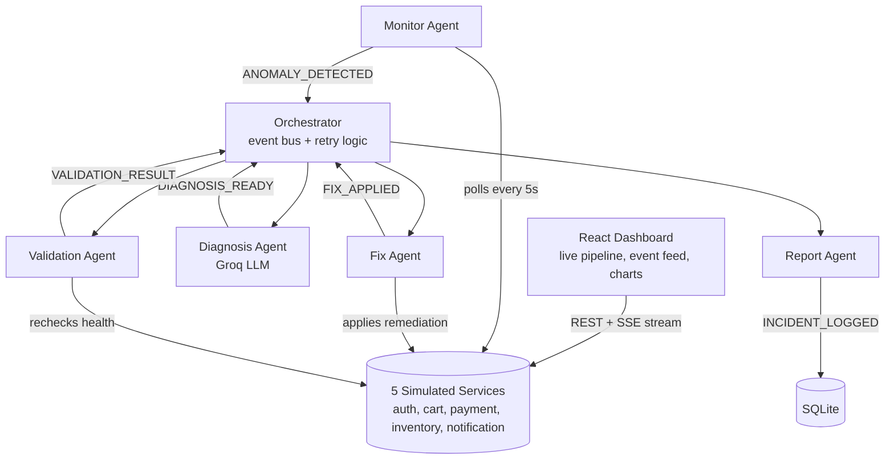

# Self-Healing E-Commerce Microservices

> Autonomous incident response for e-commerce microservices: AI agents detect, diagnose, fix, and verify failures — closed-loop, with zero human intervention and zero paid APIs.


---

## Live Demo

| | URL |
|---|---|
| **Dashboard** | https://self-healing-e-commerce-microservices-aax3tmiok-anshika494shiv.vercel.app |
| **API Docs** | https://self-healing-backend-m1e1.onrender.com/docs |

> First load may take 30–50 seconds — the free backend tier sleeps after inactivity and needs to wake up.

<details>
<summary>Known limitations of the free deployment</summary>

- Render's free tier spins down after 15 minutes of inactivity (first request takes 30–50s to wake it)
- Background tasks (the Monitor Agent) restart on wake-up, so recent history may be sparse right after a cold start
- The live deployment demonstrates the API and dashboard UI end-to-end; for the smoothest view of the full autonomous healing loop, run it locally
</details>

---

## What is this?

Real e-commerce platforms run as many small **microservices** — separate programs for login, cart, payments, inventory, and notifications. In production, these fail constantly: they crash, slow down, leak memory, or start throwing errors.

Today, one of two things happens when that occurs:

1. **A human gets paged** (PagerDuty, Datadog) and manually diagnoses and fixes it — slow, and costs 15–45+ minutes of downtime.
2. **A dumb auto-restart kicks in** (Kubernetes liveness probes) — fast, but blind. It applies the same fix to every problem and never understands *why* it broke.

This project builds the missing middle: a system that closes the full loop —

```
detect → diagnose → fix → verify → retry if needed → log
```

— using LLM reasoning and an event-driven multi-agent architecture, runnable on a single laptop for free.

**Research question:**
> Can a multi-agent, LLM-orchestrated system autonomously detect, diagnose, and recover microservice failures faster and more accurately than manual intervention — and what is the measurable reduction in Mean Time to Recovery (MTTR)?

---

## How it works



**Key design choice:** agents never call each other directly. They publish and subscribe to events on a lightweight in-process event bus — our own replacement for enterprise tools like Solace Agent Mesh. This keeps the system decoupled, testable, and is itself part of the research contribution. If validation reports the service is still broken, the Orchestrator retries with an alternate fix (up to 2 times) before escalating.

### The 5 agents

| Agent | Does | Publishes |
|---|---|---|
| **Monitor** | Polls every service every 5s, flags anomalies against thresholds | `ANOMALY_DETECTED` |
| **Diagnosis** | Sends metrics to a Groq LLM, gets back root cause + confidence + fix | `DIAGNOSIS_READY` |
| **Fix** | Executes the chosen remediation action | `FIX_APPLIED` |
| **Validation** | Re-checks the service — did it actually recover? | `VALIDATION_RESULT` |
| **Report** | Writes the incident + MTTR to the database | `INCIDENT_LOGGED` |

The **Orchestrator** sequences these agents end-to-end and owns the retry loop (up to 2 retries with an alternate fix, then escalates).

---

## Why this is different

| Tool | What it does | What it's missing |
|---|---|---|
| Datadog / PagerDuty | Detects and alerts a human | Human still diagnoses and fixes manually |
| Kubernetes probes | Auto-restarts blindly | No root-cause understanding, same fix every time |
| RCAgent / OpenRCA | LLM diagnoses the root cause | Never acts on the diagnosis, never verifies |
| **This project** | Detects → diagnoses → fixes → verifies → retries | Closes the full loop, autonomously |

---

## Dashboard

A dark operations console built for demonstrating the loop live:

- **Hero KPI strip:** MTTR versus the manual baseline, recovery rate, *measured* diagnosis accuracy, first-try rate and revenue protected.
- **Service cards:** live status, response-time sparklines, CPU/memory/error meters, and an "agents fixing…" state while an incident is open.
- **Healing pipeline:** a stepper (Detect → Diagnose → Fix → Validate → Resolved) for every active incident, with root cause, confidence and a live timer. Several incidents can run concurrently.
- **Event-bus feed:** every message the agents exchange, streamed over Server-Sent Events as it happens.
- **Fault lab:** inject any fault, or launch a multi-fault / cascading scenario.
- **Charts:** recovery time by root cause, cumulative revenue, MTTR per incident and incidents by service, each with an accessible table view.
- **Incident drawer:** the full stage timeline plus the LLM's own reasoning for any past incident.

---

## Tech stack

| Layer | Technology | Why |
|---|---|---|
| Frontend | React 19 + Vite, hand-written CSS design system | No UI-kit lock-in; fast |
| Charts | Recharts | Clean, React-native charting |
| Live updates | Server-Sent Events (`/api/stream`) + polling fallback | Real-time without WebSocket infrastructure |
| Backend | Python 3.11+ + FastAPI | Async, fast, industry standard |
| AI / LLM | Groq API, open-weight models (`openai/gpt-oss-120b` default, validated against `gpt-oss-20b` and `qwen3.8-27b`) | Free, no credit card, not locked to one model |
| Event bus | Custom async pub/sub with wildcard observers | No external broker needed, fully understood, research-novel |
| Database | SQLite + SQLModel | Zero-setup, file-based |
| Real service | Nginx in Docker (`docker-compose.yml`) | Evidence beyond pure simulation |
| Tests / CI | pytest + GitHub Actions | Backend suite and frontend build on every push |
| Deployment | Render (backend) + Vercel (frontend) | Both free tiers |

> No paid services anywhere. Groq replaces the paid Anthropic API; a hand-built event bus replaces enterprise tools like Solace Agent Mesh.

---

## Repository structure

```
.
├── backend/
│   ├── services/            # simulated services + Docker-managed Nginx
│   ├── agents/              # monitor, diagnosis, fix, validation, report + rule-based baseline
│   ├── orchestrator/        # event bus + orchestrator + retry/escalation + stage timeline
│   ├── fault_injector/      # multi-fault and cascade scenarios
│   ├── shared/              # config, event topics, LLM client, SSE hub, API-key/rate-limit
│   ├── database/            # SQLite models + queries (stats, revenue series, breakdowns)
│   ├── experiments/         # benchmark runner, end-to-end pipeline harness, stats, figures
│   ├── tests/               # pytest suite
│   └── main.py              # FastAPI entry point
├── frontend/src/
│   ├── components/          # KpiStrip, ServiceGrid, PipelineBoard, EventFeed, FaultLab, Charts, ...
│   └── lib/                 # api client, polling + SSE hooks, formatters
├── docs/results/            # findings, statistics.md, figures/
└── .github/workflows/ci.yml
```

---

## Getting started

### Prerequisites
- Python 3.11+ and Node.js 18+
- A free Groq API key from [console.groq.com](https://console.groq.com) (no card required). Only the LLM mode needs it; `--mode rule` experiments and the whole test suite run without one.
- Optional: Docker Desktop, for the real Nginx service.

### 1. Backend
```bash
cd backend
python -m venv venv
source venv/bin/activate        # Windows: venv\Scripts\activate
pip install -r requirements-dev.txt
cp ../.env.example .env         # then paste your GROQ_API_KEY
uvicorn main:app --reload --reload-exclude "*.db" --port 8000
```

The `--reload-exclude "*.db"` matters: without it, `--reload` also watches `database/incidents.db`, which the Report Agent writes on every incident. If a service is ever stuck unhealthy, that becomes a real restart loop.

### 2. Frontend
```bash
cd frontend
npm install
echo "VITE_API_URL=http://localhost:8000" > .env.local
npm run dev                     # http://localhost:5173
```

### 3. (Optional) the real container
```bash
docker compose up -d            # Nginx on :8080, registered as a sixth, real service
```

### 4. Run the tests
```bash
cd backend && python -m pytest -q
cd ../frontend && npm run lint && npm run build
```

### Configuration

| Variable | Default | Purpose |
|---|---|---|
| `GROQ_API_KEY` | none | LLM access for the Diagnosis Agent |
| `GROQ_MODEL` | `openai/gpt-oss-120b` | Which Groq model diagnoses |
| `ALLOWED_ORIGINS` | localhost:5173,3000 | CORS allow-list |
| `MONITOR_POLL_INTERVAL` | `5` | Seconds between health sweeps |
| `API_KEY` | empty (open) | If set, fault-injection, heal and scenario endpoints require `X-API-Key`. Set it on any public deployment, and `VITE_API_KEY` in the frontend. |
| `RATE_LIMIT_MAX` / `RATE_LIMIT_WINDOW` | `20` / `60` | Per-IP limit on mutating endpoints |

### API overview

| Endpoint | Purpose |
|---|---|
| `GET /api/services`, `/api/history` | Live health and rolling metric samples |
| `GET /api/stream` | Server-Sent Events: every pipeline event as it happens |
| `GET /api/active-incidents`, `/api/incidents`, `/api/incidents/{id}` | Live and historical incidents, with stage timeline |
| `GET /api/stats`, `/api/mttr-chart`, `/api/revenue-series`, `/api/breakdown` | Aggregates behind the dashboard |
| `POST /api/services/{name}/fault/{type}` | Inject `crash \| slow \| memory \| error` *(auth + rate-limited)* |
| `GET /api/scenarios`, `POST /api/scenarios/{id}/run` | Multi-fault and cascade scenarios *(run is auth + rate-limited)* |

Watch the loop fire from a terminal:
```bash
curl -X POST http://localhost:8000/api/services/payment/fault/crash   # add -H "X-API-Key: ..." if API_KEY is set
curl -N http://localhost:8000/api/stream
```

### Reproduce the research results
```bash
cd backend
# 1) Original benchmark: 20 scenarios x 3 trials per model (needs GROQ_API_KEY)
python -m experiments.run_experiments openai/gpt-oss-120b

# 2) End-to-end pipeline timing, including detection latency (no API key with --mode rule)
python -m experiments.run_pipeline --service payment --fault all --trials 5 --mode rule
python -m experiments.run_pipeline --scenario everything-breaks --trials 5 --mode rule

# 3) Real Docker container evidence (Docker Desktop running + `docker compose up -d`)
python -m experiments.run_pipeline --service nginx --fault crash --trials 10 --mode rule

# 4) Statistics (CIs, McNemar, Kruskal-Wallis) and publication figures
python -m experiments.analyze          # -> docs/results/statistics.md
python -m experiments.make_figures     # -> docs/results/figures/*.png|pdf
```

---

## Research findings

Latest run (September 2026, 180 trials across 3 free Groq models):

| Metric | Result |
|---|---|
| LLM diagnosis accuracy (pooled) | 99.4% (179/180) |
| Rule-based baseline accuracy | 100% (180/180) |
| Mean MTTR | 3.20s vs. a 900s manual baseline (~99.6% reduction) |
| Model dependency | Accuracy held up across all 3 models tested — not locked to one vendor's model |

The one LLM miss was a transient API/JSON-parsing failure caught by the system's safe-default fallback, not a reasoning error. Full breakdown, per-model numbers, and honest caveats (e.g. why "recovery rate" isn't yet a fix-sensitive metric) live in [`docs/results/model-comparison.md`](docs/results/model-comparison.md) and [`backend/experiments/findings.md`](backend/experiments/findings.md).

This project targets a publishable paper — the contribution is a lightweight, event-driven, LLM-diagnosed closed-loop self-healing system, runnable on commodity hardware at zero API cost, evaluated against a manual-response baseline on a reproducible testbed. Outline and methodology: [`docs/research-paper.md`](docs/research-paper.md).

### Further reading

| Doc | What's in it |
|---|---|
| [`docs/architecture.md`](docs/architecture.md) | System design in detail |
| [`docs/results/retry-loop-test.md`](docs/results/retry-loop-test.md) | Verification of the retry/escalation logic, including a feedback-loop bug found and fixed |
| [`docs/setup-guide.md`](docs/setup-guide.md) | Build-from-scratch setup walkthrough |
| [`docs/progress-tracker.md`](docs/progress-tracker.md) | Phase-by-phase build status |

---

## License

MIT
